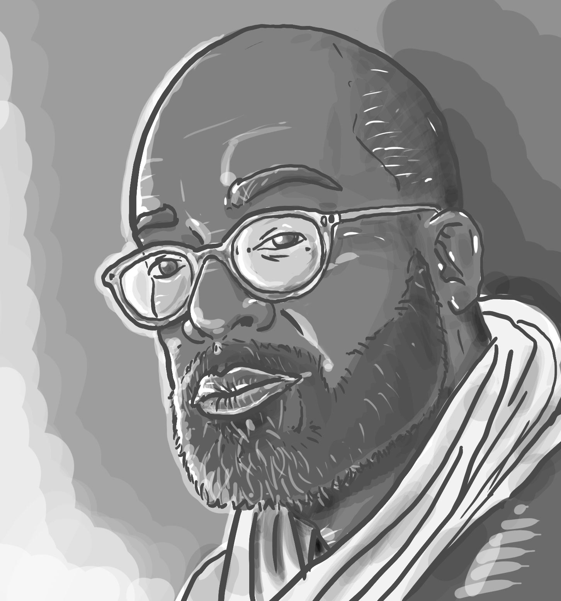
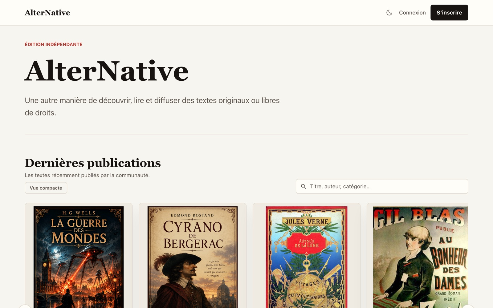
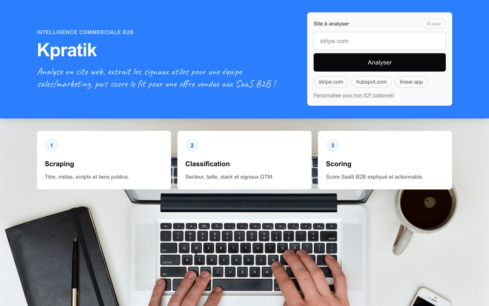
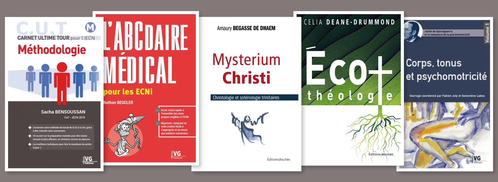

<div align="center">



# Portfolio Patrice Philétas

**Portfolio développeur full stack et graphiste éditorial.**

[](https://portfoliopatphiletas.vercel.app)
&nbsp;
[](https://github.com/patphiletas/Portfolio)
&nbsp;
[](https://nextjs.org/)
&nbsp;
[](https://react.dev/)
&nbsp;
[](https://www.typescriptlang.org/)
&nbsp;
[](https://tailwindcss.com/)

</div>

---

## Aperçu

<div align="center">
  
  
  
</div>

<br/>

Ce portfolio présente mon parcours de reconversion vers le développement web full stack après près de 20 ans dans le graphisme éditorial. Il rassemble mes projets web, mes compétences techniques, mon expérience en direction artistique et les liens de contact pour une recherche d'alternance dès que possible (prochaine rentrée : janvier 2027).

---

## Fonctionnalités

| Fonctionnalité | Description |
|---|---|
| Accueil | Nom, accroche, autoportrait dessiné, boutons « Voir les projets » et CV, sommaire façon livre |
| Projets web | Présentés comme un sommaire de revue : entrées numérotées séparées par un filet, image 16:10 sans cadre en alternance gauche/droite, technologies en petites capitales, liens soulignés « Voir le site ↗ · Code source ↗ · README ↗ » (plus de cartes, boutons ni pastilles) |
| Démos vidéo | Courte démo muette en boucle (WebM, 8 à 11 s, 400 à 730 Ko) pour chacun des quatre projets : lecture au survol sur ordinateur, quand la carte est visible sur mobile, image fixe si « réduire les animations » est activé ; vidéo téléchargée seulement à la lecture |
| Graphisme | Page `/graphisme` : **sélection** de 12 pièces en mosaïque en tête de page (liste `SELECTION_IDS` dans `lib/graphisme.ts`), sections Édition et Web repliées (« Voir les 29 couvertures »), sommaire typographique numéroté des six domaines, en deux colonnes et sans images, images sans cadre avec légendes discrètes (visionneuse au clic, avec le lien « Aperçu en ligne ↗ » vers le feuilletage Calaméo quand il existe), clients en liste typographique ; même langage éditorial que l'accueil (pas de cartes ni de pastilles) |
| Parcours | Présentation de la reconversion, de la formation Ada Tech School et de l'expérience professionnelle |
| Compétences | Regroupées en quatre colonnes : front-end, back-end, outils & IA, graphisme |
| Contact | Liens directs vers email, téléphone, GitHub, LinkedIn, CV et portfolio PDF |
| Thème clair/sombre | Gestion du thème via contexte React et variables CSS |
| Responsive | Interface adaptée aux écrans mobiles, tablettes et desktop |

---

## Stack technique

| Couche | Technologie |
|---|---|
| Framework | Next.js 16 avec App Router |
| Interface | React 19, TypeScript |
| Styles | Tailwind CSS 4, CSS variables |
| Animations | Framer Motion |
| Qualité | ESLint, configuration Next.js |
| Déploiement | Vercel |

---

## Structure du projet

```txt
portfolio-patphiletas/
├── app/
│   ├── components/      # Cover (sommaire), Chapter, About, Projects, ProjectMedia (vignette + démo vidéo), Graphisme, Contact, Navbar
│   ├── context/         # ThemeContext
│   ├── globals.css      # Thèmes, variables CSS et styles globaux
│   ├── layout.tsx       # Layout racine
│   └── page.tsx         # Composition des sections
├── lib/
│   └── data.ts          # Projets, items graphisme, compétences et clients
├── public/
│   ├── images/          # Captures projets, portrait et visuels graphisme
│   ├── videos/          # Démos WebM des projets (alternative, kpratik, real-book, on-sort)
│   ├── cv-patrice-philetas.pdf
│   └── portfolio-graphisme.pdf
├── scripts/
│   └── capturer-demo.mjs  # Filme la démo d'un projet (Chrome headless → WebM), un scénario par projet
└── package.json
```

---

## Installation

```bash
npm install
```

---

## Lancement

```bash
npm run dev
```

Le site est ensuite disponible sur :

```txt
http://localhost:3000
```

---

## Scripts disponibles

| Script | Description |
|---|---|
| `npm run dev` | Lance le serveur de développement Next.js |
| `npm run build` | Génère la version de production |
| `npm run start` | Lance l'application après build |
| `npm run lint` | Exécute ESLint |

---

## Contenus principaux

| Section | Source |
|---|---|
| Projets web | `lib/data.ts` (texte) et `public/images/<projet>.jpg` (captures 1600×1000) |
| Accueil | `app/components/Cover.tsx` |
| Démos vidéo | `public/videos/*.webm`, champ `video` du projet dans `lib/data.ts` ; refaire avec `node scripts/capturer-demo.mjs <projet|tous>` |
| Travaux graphisme | `lib/graphisme.ts` (images par domaine, `SELECTION_IDS` pour la sélection en tête de page) et `public/images/graphisme/` |
| CV | `public/cv-patrice-philetas.pdf` |
| Portfolio graphisme | `public/portfolio-graphisme.pdf` |
| Thème | `app/context/ThemeContext.tsx` et `app/globals.css` |

---

## Prochaines évolutions

- [x] Présentation des projets web avec liens README, démo et GitHub
- [x] Section graphisme avec références éditoriales
- [x] Mode clair/sombre
- [ ] Ajouter une capture globale du portfolio dans le README
- [ ] Ajouter des tests d'accessibilité et de rendu responsive
- [ ] Enrichir chaque projet avec une page détail dédiée

---

<div align="center">

Développé comme portfolio de reconversion full stack · Patrice Philétas 2026

</div>
